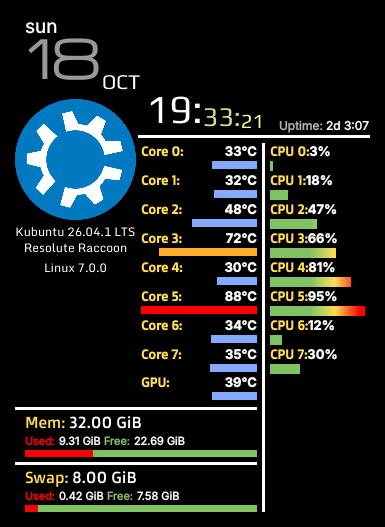
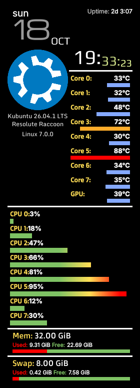
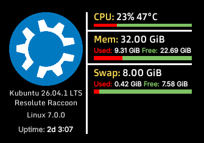

Simple Monitor for Plasma 6
===========================

*Deutsch weiter unten.*

A simple system monitor widget for the KDE Plasma desktop, written entirely
in QML and JavaScript: clock and date, distribution logo, CPU load per core,
CPU and GPU temperatures, memory, swap and uptime. Three skins: Default,
Column and Minimalistic.

Project page: https://github.com/krumbinet/plasma-simplemonitor6 – bug reports and pull requests welcome.

This is a port of [plasma-simpleMonitor](https://github.com/dhabyx/plasma-simpleMonitor)
by Dhaby Xiloj and Konstantin Shtepa (Plasma 5) to **Plasma 6**.

| Default | Column | Minimalistic |
|---|---|---|
|  |  |  |

What changed compared to the Plasma 5 version
---------------------------------------------

- All values come from the Plasma 6 sensor system (`ksystemstats`, QML module
  `org.kde.ksysguard.sensors`). The old `systemmonitor` data engine
  (`ksysguardd`) no longer exists.
- No hardware specific code any more: Intel, AMD, NVIDIA etc. are handled by
  `ksystemstats`. Sensors that do not exist on a machine are simply hidden.
  The calls to `nvidia-smi`, `aticonfig` and `amdconfig` are gone.
- Distribution and kernel are read from the sensor system as well. If there is
  no built-in logo for your distribution, the logo your distribution ships
  (`LOGO=` in `/etc/os-release`) is used, otherwise Tux.
- New option: CPU temperature per core, average only or maximum only
  (useful for AMD CPUs, which report one temperature for all cores).
- Settings dialogs rebuilt with Kirigami / QtQuick Controls 2.
- The Minimalistic skin can now be selected in the settings.
- New plugin ID `io.github.krumbinet.simplemonitor`, so it can be installed next
  to the original. Settings of the Plasma 5 widget are not taken over.

Requirements
------------

- KDE Plasma 6 (tested target: Plasma 6.6, Qt 6)
- `ksystemstats` and its QML module (normally installed with Plasma)

| Distribution | Package with the QML module |
|---|---|
| Debian, Ubuntu, Kubuntu, KDE neon | `qml6-module-org-kde-ksysguard` |
| Arch, Manjaro, Fedora | `libksysguard` |
| openSUSE | `libksysguard6` |

Package names may differ between releases; the module you need is
`org.kde.ksysguard.sensors`. If it is missing, the widget shows an error
mentioning that module.

For building: `zip`, `gettext` (`msgfmt`) and `python3`.

Installation
------------

From the sources, for the current user, no root needed:

```sh
git clone https://github.com/krumbinet/plasma-simplemonitor6 plasma-simplemonitor6
cd plasma-simplemonitor6
./install.sh
```

Then right click on the desktop → *Add or Manage Widgets* → *Simple System Monitor*.

From a `.plasmoid` file:

```sh
kpackagetool6 -t Plasma/Applet -i plasma-simplemonitor-0.7.1.plasmoid   # install
kpackagetool6 -t Plasma/Applet -u plasma-simplemonitor-0.7.1.plasmoid   # upgrade
```

Remove with `./uninstall.sh` or
`kpackagetool6 -t Plasma/Applet -r io.github.krumbinet.simplemonitor`.

Development
-----------

```
package/              the widget itself (what ends up in the .plasmoid)
  metadata.json       name, ID, version
  contents/config/    settings schema (main.xml) and settings pages
  contents/ui/        QML: main.qml -> MonitorView.qml -> skins/*
  contents/ui/SystemData.qml   all sensor access in one place
po/                   translations (one <lang>.po per language)
build.sh              compiles translations, builds build/*.plasmoid
install.sh            build + install/upgrade for the current user
test.sh               install + open the widget in a window (shows QML errors)
```

- `./test.sh` opens the widget in its own window. It uses `plasmoidviewer`
  (package `plasma-sdk`) if available, otherwise `plasmawindowed`.
- After changing an already placed widget: `systemctl --user restart plasma-plasmashell`.
- Which sensors exist on your machine: `kstatsviewer --list`.

### Translations

```sh
cd po
./Messages.sh        # update the template and all languages after code changes
./Messages.sh fr     # start a new translation (French as an example)
```

Then edit `po/<lang>.po` (e.g. with Lokalize or any text editor) and run
`./build.sh`. Please open a pull request with only the `.po` file.

Translations exist for: German, Spanish, Basque, Polish, Russian, Turkish,
Chinese (simplified). Many of them need updates for the new strings – help is welcome!

License
-------

GNU General Public License version 3 or later, see [COPYING](COPYING).

- Original widget © 2013-2017 Dhaby Xiloj, Konstantin Shtepa and contributors
- Plasma 6 port © 2026 krumbinet and contributors, see [AUTHORS.md](AUTHORS.md)
- Fonts (Doppio One, Michroma, Monda, Play): SIL Open Font License, see `package/contents/fonts/*/OFL.txt`
- Distribution logos are trademarks of their respective owners.

---

Deutsch
=======

Ein einfaches Systemmonitor-Widget für den KDE-Plasma-Desktop, komplett in
QML und JavaScript: Uhr und Datum, Distributionslogo, CPU-Last pro Kern,
CPU- und GPU-Temperaturen, Arbeitsspeicher, Swap und Laufzeit. Drei Skins:
Standard, Spalte und Minimalistisch.

Projektseite: https://github.com/krumbinet/plasma-simplemonitor6 – Fehlerberichte und Pull Requests sind willkommen.

Dies ist die Portierung von [plasma-simpleMonitor](https://github.com/dhabyx/plasma-simpleMonitor)
von Dhaby Xiloj und Konstantin Shtepa (Plasma 5) auf **Plasma 6**.

Was sich gegenüber der Plasma-5-Version geändert hat
----------------------------------------------------

- Alle Werte kommen aus dem Sensor-System von Plasma 6 (`ksystemstats`,
  QML-Modul `org.kde.ksysguard.sensors`). Die alte Datenquelle
  `systemmonitor` (`ksysguardd`) gibt es nicht mehr.
- Kein hardwarespezifischer Code mehr: Intel, AMD, NVIDIA usw. erledigt
  `ksystemstats`. Sensoren, die es auf einem Rechner nicht gibt, werden
  einfach ausgeblendet. Die Aufrufe von `nvidia-smi`, `aticonfig` und
  `amdconfig` sind entfallen.
- Distribution und Kernel kommen ebenfalls aus dem Sensor-System. Gibt es für
  die Distribution kein eingebautes Logo, wird das Logo der Distribution
  (`LOGO=` in `/etc/os-release`) verwendet, sonst Tux.
- Neue Einstellung: CPU-Temperatur pro Kern, nur Durchschnitt oder nur
  Höchstwert (praktisch bei AMD-CPUs, die eine Temperatur für alle Kerne melden).
- Einstellungsdialoge neu mit Kirigami / QtQuick Controls 2.
- Der Skin „Minimalistisch“ ist jetzt in den Einstellungen auswählbar.
- Neue Plugin-ID `io.github.krumbinet.simplemonitor`, damit das Widget neben dem
  Original installiert werden kann. Einstellungen des Plasma-5-Widgets werden
  nicht übernommen.

Voraussetzungen
---------------

- KDE Plasma 6 (Zielversion beim Test: Plasma 6.6, Qt 6)
- `ksystemstats` mit QML-Modul (wird normalerweise mit Plasma installiert),
  Paketnamen siehe Tabelle oben
- Zum Bauen: `zip`, `gettext` (`msgfmt`) und `python3`

Installation
------------

Aus dem Quellcode, nur für den eigenen Benutzer, ohne root:

```sh
git clone https://github.com/krumbinet/plasma-simplemonitor6 plasma-simplemonitor6
cd plasma-simplemonitor6
./install.sh
```

Danach Rechtsklick auf den Desktop → *Miniprogramme hinzufügen oder verwalten*
→ *Einfacher Systemmonitor*.

Aus einer `.plasmoid`-Datei:

```sh
kpackagetool6 -t Plasma/Applet -i plasma-simplemonitor-0.7.1.plasmoid   # installieren
kpackagetool6 -t Plasma/Applet -u plasma-simplemonitor-0.7.1.plasmoid   # aktualisieren
```

Entfernen mit `./uninstall.sh`.

Mitmachen
---------

- `./test.sh` installiert den aktuellen Stand und öffnet das Widget in einem
  eigenen Fenster; QML-Fehler erscheinen im Terminal.
- Nach Änderungen an einem bereits platzierten Widget:
  `systemctl --user restart plasma-plasmashell`.
- Welche Sensoren es auf dem eigenen Rechner gibt: `kstatsviewer --list`.
- Übersetzungen: siehe Abschnitt *Translations* oben.

Fehlerberichte bitte mit Distribution, Plasma-Version, CPU/GPU und der
Ausgabe von `kstatsviewer --list | grep -E "^(cpu/all|gpu|memory)"`.

Lizenz
------

GNU General Public License Version 3 oder neuer, siehe [COPYING](COPYING).
Urheber und Mitwirkende siehe oben und [AUTHORS.md](AUTHORS.md).
